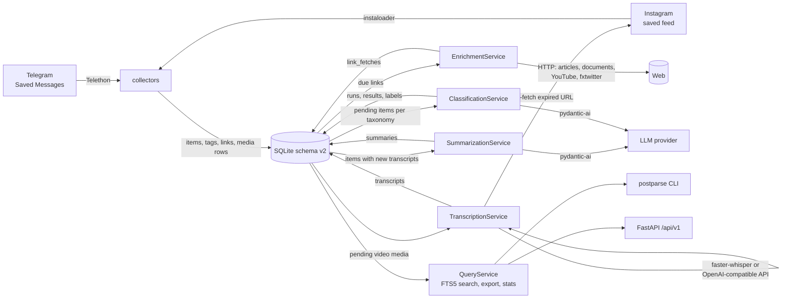
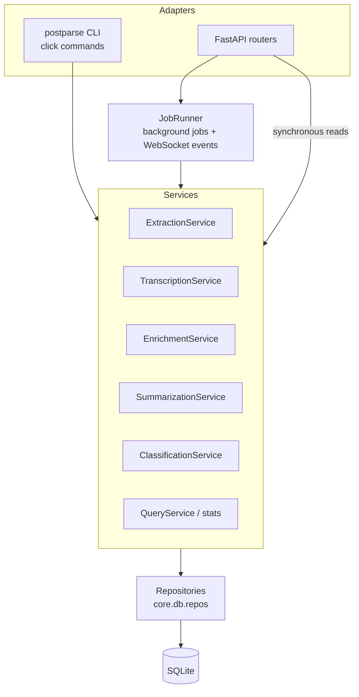

# Architecture

PostParse is a layered application. The CLI (`postparse.cli`) and the REST API
(`postparse.api`) are thin adapters over one set of **services**
(`postparse.services`). Services own the workflows and talk to the schema v2
database through **repositories** (`postparse.core.db.repos`) and to the outside
world through **collectors**, **media** backends, **enrichment fetchers** and the
**LLM** layer.

## Module map

| Package | Responsibility |
|---|---|
| `postparse.cli` | Click / rich-click commands (`extract`, `transcribe`, `enrich`, `summarize`, `classify`, `search`, `stats`, `db`, `check`, `config`, `serve`, `info`). Loads `config/.env` on import. |
| `postparse.api` | FastAPI app (`main.create_app`), service container (`deps.py`), routers, schemas, `JobRunner` (`jobs/`), job/WebSocket/cache managers (`services/`), middleware (auth, logging, rate limit, CORS). |
| `postparse.services` | Workflows used by CLI and API: `ExtractionService`, `TranscriptionService`, `SummarizationService`, `EnrichmentService`, `ClassificationService`, `QueryService` (search, detail, export), `stats`. |
| `postparse.collectors` | Incremental collectors: `telegram/` (Telethon, Saved Messages) and `instagram/` (instaloader, saved feed); credentials from env (`credentials.py`); typed errors (`base.py`: `AuthRequired`, `RateLimited`, `CredentialsMissing`). |
| `postparse.media` | Video fetching (`fetch.py`: stored URL or Instagram re-fetch), audio probing/decoding with PyAV (`audio.py`), ASR backends (`transcription/`: local faster-whisper, OpenAI-compatible API), `[transcription]` options. |
| `postparse.enrichment` | Link fetchers (`fetchers/`: generic HTML via trafilatura/readability, documents via markitdown, YouTube, X/fxtwitter, Instagram = skipped), `FetchRouter` with per-domain throttle and retry policy, `[enrichment]` options. |
| `postparse.classification` | `TaxonomySpec` (config → taxonomy), prompts, `TaxonomyClassifier` (pydantic-ai agent with structured output). |
| `postparse.summarization` | `Summarizer` (pydantic-ai agent) and its output schema. |
| `postparse.llm` | Provider config (`config.py`), pydantic-ai model factory (`client.py`), served-model discovery, provider health checks. |
| `postparse.core.db` | Connection handling, SQL migrations (`migrations/*.sql`), dataclass models, filters, repositories, FTS5 search documents, the one-off v1 importer (`legacy_v1.py`). |
| `postparse.core` | Shared helpers: UTC timestamp format (`timeutil.py`), URL extraction/normalization (`urls.py`), hashtag/mention parsing (`text.py`), `ConfigManager` (`utils/config.py`). |
| `postparse.config` | Typed `Settings` (paths, database location) from TOML + `POSTPARSE_*` environment variables. |

## Data flow

Every write that changes searchable content (item text, tags, transcripts,
summaries, fetched link texts) refreshes the item's row in `search_docs` in the
same transaction; triggers keep the FTS5 index `items_fts` in sync. See
[Database](database.md#full-text-search).

## The refresh pipeline

The recommended order of the processing steps is:

1. `postparse extract all` — collect new items (incremental; stops at known posts).
2. `postparse transcribe run` — transcribe pending videos (throttled).
3. `postparse enrich run` — fetch linked pages, documents, videos, X posts.
4. `postparse summarize run` — summarize items whose transcript is newer than their summary
   (the summary input includes fetched link texts, hence after `enrich`).
5. `postparse classify run --taxonomy <name>` — classify pending items (the
   classifier input includes caption, transcripts, summary and link texts).

Every step is idempotent and incremental: it only processes what is pending and
commits per item (or per batch), so an interrupted run keeps its progress. See
the [operations runbook](operations.md#refresh-pipeline).

## CLI and API share the services

* The CLI builds a service per command from `Settings` (paths) and the TOML
  `ConfigManager`.
* The API builds all services once in the FastAPI lifespan
  (`postparse.api.deps.build_services`) and keeps them on `app.state.services`.
  Long-running work (extraction, transcription, summaries, enrichment,
  classification runs) is submitted to the `JobRunner`, which tracks state in the
  in-memory `JobManager` and streams progress over WebSockets. See the
  [API reference](api-reference.md#jobs).

## LLM layer

`postparse.llm` turns each `[[llm.providers]]` entry into a pydantic-ai model:

* **Protocol**: `openai` (OpenAI and every OpenAI-compatible server such as
  llama.cpp, LM Studio, Ollama, vLLM) or `anthropic`; derived from the provider
  name unless `api_type` is set.
* **Structured output**: `native` JSON schema (`response_format`; llama.cpp
  compiles it into a grammar) for endpoints with `api_base`, `tool` calls for
  cloud APIs; override with `output_mode`.
* **Concurrency**: 1 request at a time for LAN/localhost endpoints (one
  llama.cpp slot), 4 for cloud APIs; override with `max_concurrency`.
* **Model discovery**: self-hosted servers are asked which model they serve
  (`/v1/models`, Ollama `/api/ps`) once per process.

Classification and summaries both use this layer; `postparse check llm` and
`GET /health/ready` test the configured providers.
