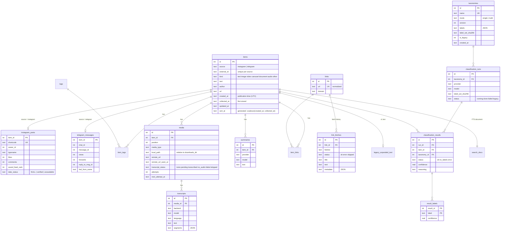

# Database (schema v2)

PostParse stores everything in one SQLite file, by default
`<data_dir>/postparse.db` (`data/postparse.db`; override with `[database] db_path`
or `POSTPARSE_DB_PATH`). The schema is defined by the SQL migrations in
`src/postparse/core/db/migrations/` and requires **SQLite 3.45 or newer**
(STRICT tables, `concat_ws`, JSON functions); the check runs on every
connection.

Every connection enables `foreign_keys`, a 5 s `busy_timeout`,
`synchronous = NORMAL` and in-memory temp storage.

## Entity-relationship diagram



## Tables

| Table | Purpose |
|---|---|
| `items` | One row per collected post or message, any source. `UNIQUE (source, external_id)`: Instagram `external_id` is the shortcode, Telegram `"<chat_id>:<message_id>"`. |
| `instagram_posts`, `telegram_messages` | Source-specific details (1:1 with `items`). |
| `tags`, `item_tags` | Hashtags and mentions (`kind` = `hashtag` / `mention`, names case-insensitive). |
| `media` | Photos, videos, documents of an item. `local_path` is a POSIX path relative to `Settings.downloads_dir` (Telegram downloads); Instagram videos only carry `remote_url` + `remote_url_seen_at`. `transcript_status`, `attempts`, `last_error`, `next_attempt_at` form the transcription queue. |
| `transcripts` | One transcript per media, backend and model (`UNIQUE (media_id, backend, model)`), with optional JSON segments. |
| `summaries` | LLM summaries per item; the newest row is the current one. |
| `links`, `item_links` | Normalized URLs found in item texts and the items that contain them. |
| `link_fetches` | Fetch history per link (`fetcher`, `status`, `http_status`, `title`, `text`, JSON `metadata`, `error`). The newest `ok` fetch is used for search. Fetcher `legacy_v1` marks texts imported from v1. |
| `legacy_expanded_text` | v1 "expanded text" that could not be attributed to a single link; kept for search until all links of the item have a fresh fetch. |
| `taxonomies` | Stored taxonomies with `version`, JSON `labels` and `label_set_sha256`. |
| `classification_runs` | One row per `classify run` / persisted API classification (`provider`, `model`, `label_set_sha256`, `prompt_sha256`, `params`, counts). |
| `classification_results`, `result_labels` | Result per (run, item) with `status` `ok` / `no_labels` / `error`, confidence, reasoning; labels per result. Results are never overwritten: reprocessing adds a new run. |
| `search_docs`, `items_fts` | Denormalized search document per item and its FTS5 index. |
| `schema_migrations` | Applied migrations (version, name, checksum, time). |

## Views

`v_current_classification` returns the **newest successful result**
(`ok` or `no_labels`) per (item, taxonomy). `error` results never replace a
previous good result. Search filters such as `--label topics:recipe` and the
`labels` of items in exports and API responses are based on this view.

```sql
SELECT i.id, i.text
FROM items AS i
JOIN v_current_classification AS v ON v.item_id = i.id
JOIN taxonomies AS t ON t.id = v.taxonomy_id AND t.name = 'topics'
JOIN result_labels AS rl ON rl.result_id = v.result_id AND rl.label = 'recipe';
```

## Timestamps

* Every stored timestamp is **UTC text** `YYYY-MM-DDTHH:MM:SS.sssZ`
  (millisecond precision, literal `Z`), enforced by `CHECK` constraints. The
  format sorts lexicographically in chronological order, so string comparisons
  and indexes are correct.
* `items.created_at` is the publication time (may be `NULL` when unknown),
  `collected_at` the time PostParse first stored the item, `sort_at` a generated
  column `coalesce(created_at, collected_at)` used for ordering and date filters.
* CLI/API date filters (`--from` / `--to`, `date_from` / `date_to`) are whole
  days in UTC, inclusive.

## Full-text search

`search_docs` holds one document per item with three columns:

* `body` — the item text,
* `extra` — the latest transcript per media, the latest summary, fetched link
  titles/texts and the legacy expanded text,
* `tags` — space-separated tag names.

`items_fts` is an external-content FTS5 table over `search_docs`
(`tokenize = 'unicode61 remove_diacritics 2'`); triggers on `search_docs` keep it
in sync. Repositories that change searchable content refresh the affected
documents in the same transaction. After direct SQL edits run
`postparse db reindex` (rebuilds all documents and optimizes the index);
`postparse db check` reports when the index and `items` are out of sync.

Query syntax (CLI `search items QUERY`, API `q`): words are ANDed, `"exact
phrase"`, `prefix*`. Snippets mark matched terms with `[...]`.

## Pending scopes (classification)

`ClassificationRepo.pending_items` decides which items `classify run` sends to
the LLM. A result is **done** for a taxonomy when its status is `ok` or
`no_labels` **and** its run used the taxonomy's current `label_set_sha256`.

| Scope | Selected items |
|---|---|
| `default` | not done **and** (`collected_at >= taxonomy.created_at` **or** the item has no successful result in any taxonomy) |
| `backfill` | every item that is not done |
| `reprocess` | every item matching the filters |

So adding a taxonomy does not re-classify your whole archive automatically:
`default` only picks new items and never-classified items. A label-set change
bumps `taxonomies.version` and the hash but keeps `created_at`, so `default`
keeps its cut-off while `backfill` re-classifies older items for the new label
set. Details: [Taxonomies](taxonomies.md).

## Migrations

* Migration files are named `NNNN_name.sql` and shipped as package data.
  Pending migrations are applied in order, each in its own `BEGIN IMMEDIATE`
  transaction together with its `schema_migrations` row and
  `PRAGMA user_version`.
* Checksums are computed over the file text with normalized line endings; an
  applied migration whose checksum changed is refused.
* Write commands (`extract`, `transcribe`, `enrich`, `summarize`, `classify
  run`) open the database through `Database`, which creates it and applies
  pending migrations on first use. Read commands (`search`, `stats`,
  `db export`) never create or migrate the file.
* `postparse db migrate` applies pending migrations explicitly (creating the
  database if needed); `postparse db check` verifies integrity, foreign keys,
  schema version and the search index.

| Version | File | Change |
|---|---|---|
| 1 | `0001_initial.sql` | Schema v2 tables, view, FTS5 index and triggers |
| 2 | `0002_instagram_date_status.sql` | `instagram_posts.date_status` |

## Upgrading from schema v1

PostParse 0.1 used `data/social_media.db` (schema v1, `SocialMediaDatabase`).
`postparse db migrate-v1` converts it into a **new** v2 file:

```bash
postparse db migrate-v1 --source data/social_media.db --target data/postparse.db \
    --report data/migrate-v1-report.json
```

* The source is opened strictly **read-only**. The target is built as
  `<target>.tmp`, verified against counts computed from the source, and only
  then moved into place. An existing target is refused unless `--overwrite` is
  passed. Rerunning the migration produces the same logical content.
* Back up the v1 file anyway before you start (see the
  [runbook](operations.md#backup)).
* Install the `migrate` extra (`uv sync --extra migrate`) to repair mojibake in
  v1 "expanded text" with ftfy; without it the text is imported unchanged (the
  report states `ftfy_available`).

### v1 → v2 mapping

| v1 | v2 |
|---|---|
| Instagram posts | `items` (`external_id` = shortcode) + `instagram_posts` |
| Telegram messages | `items` (`external_id` = `"<chat_id>:<message_id>"`) + `telegram_messages`; messages of test chat `123456` and their analysis rows are dropped |
| `instagram_hashtags`, `instagram_mentions` | `tags` / `item_tags`; Telegram tags are re-derived from the message text |
| Telegram `media_urls` | `media` with `local_path` (relative to `--downloads-dir`); orphan files in the downloads folder are recovered |
| Instagram `GraphVideo` posts | one `media` row (`video`, `transcript_status = pending`); the expired CDN URLs are not migrated, so transcription re-fetches the post |
| URLs in item text | `links` / `item_links` |
| `content_expanded` | raw URL lists → links; scraped text of a single-link item → `link_fetches` with fetcher `legacy_v1`; everything else → `legacy_expanded_text` |
| `multilabel_llm` results | taxonomy `topics` (multi), one run with status `legacy` per (classifier, provider, model) |
| `recipe_llm` results | taxonomy `recipe_legacy` (single, `is_legacy = 1`, labels `recipe` / `not_recipe`) |

**Timestamps.** v1 stored Instagram `created_at` as instaloader's *naive local*
`post.date`. The migration interprets these values in `--instagram-tz`
(default **`Europe/Berlin`**, the time zone of the machine that collected them;
ambiguous times use `fold=0`) and converts them to UTC. All other naive v1
timestamps (`fetched_at`, `saved_at`, `analyzed_at`) are SQLite
`CURRENT_TIMESTAMP` values and therefore already UTC.

**`date_status`.** Because the Instagram dates above are an assumption,
migrated posts get `instagram_posts.date_status = NULL` (unverified). The
collector stores instaloader's `date_utc` directly and marks new posts
`verified`. `postparse extract instagram --refresh-dates [--refresh-limit N]`
re-fetches unverified posts and sets `verified`, or `unavailable` when the post
cannot be fetched any more (deleted or private).

After the migration, the next `postparse enrich run` re-enriches links whose
only text came from v1 (`--no-legacy` skips them), and `postparse transcribe
run` works through the migrated Instagram videos.
